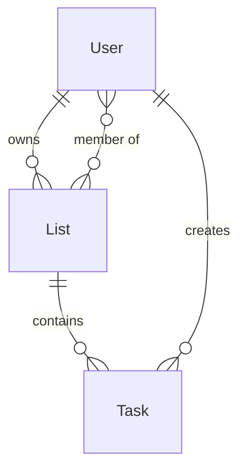
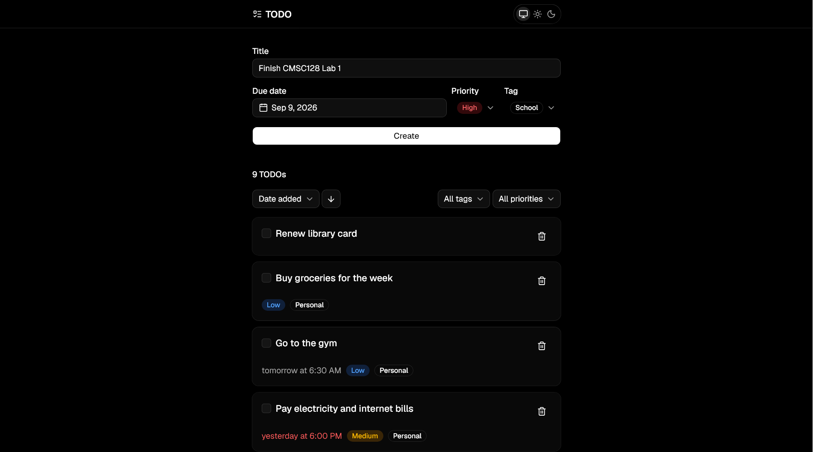
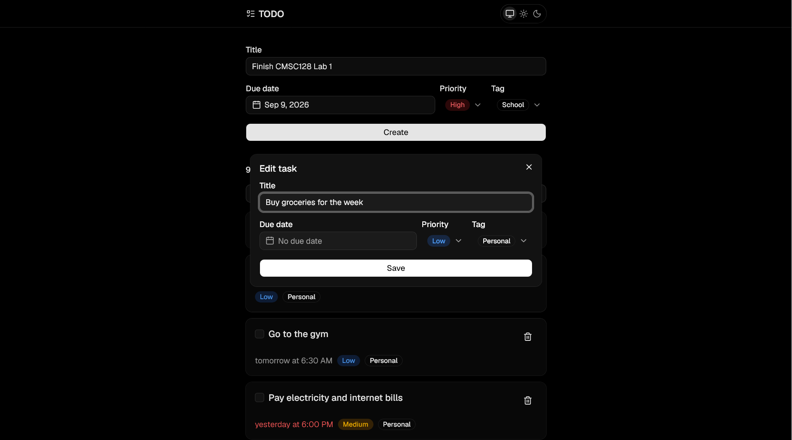
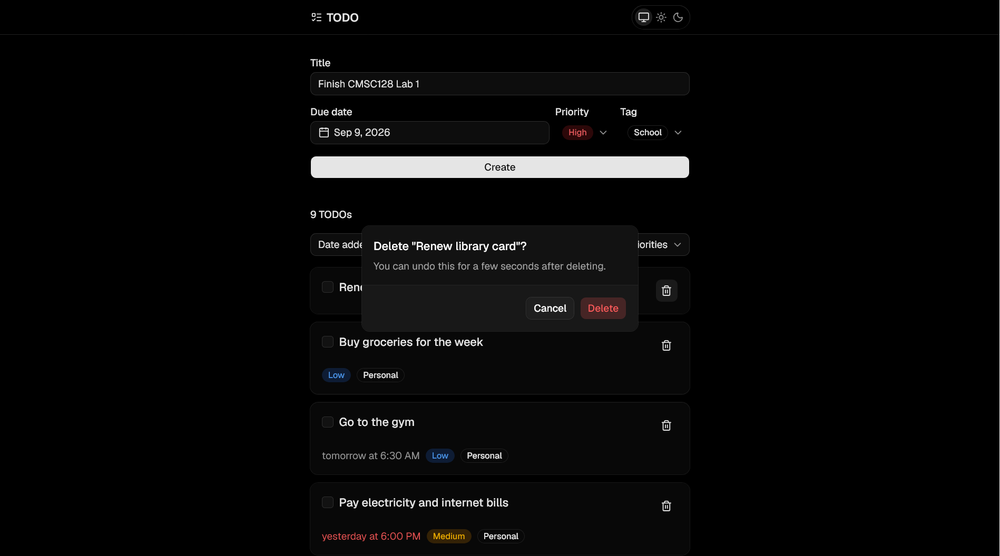

# TODO

A to-do list app built with the MERN stack.

## Features

### Task Management

- Task list showing title, due date, priority, and tag for every task.
- Add tasks with title, due date and time, priority, and tag.
- Edit any field of a task.
- Delete tasks behind a confirmation dialog.
- Undo a delete within 5 seconds via a toast; the task is only removed from the database once the toast closes (`frontend/src/hooks/useTasks.ts`).
- Mark tasks as done, shown with a checkbox and strikethrough.
- Sort by date added, due date, priority, or tag (ascending or descending), and filter by tag and priority, client-side (`frontend/src/hooks/useTaskView.ts`).
- Tasks persist in MongoDB across browser refreshes and server restarts.

### Lists

- Each account gets a Personal list on registration.
- Create, rename, and delete collaborative lists.
- Add users to a list by email.
- Switch between your lists and lists you were added to.
- Shared lists show who created each task.

### Accounts

- Register, log in, and log out.
- Stay logged in across refreshes and backend restarts.
- Profile page, and settings to change display name, email, and password.
- Password recovery via an emailed reset link.

## Tech Stack

- Frontend: React + Vite + TypeScript
- Backend: Node.js + Express + TypeScript
- Database: MongoDB (via Mongoose)
- Validation: Zod
- Auth: server-side sessions (`express-session` + `connect-mongo`), Argon2id password hashing (`argon2`)
- Email: `nodemailer` over SMTP
- Package manager: pnpm (monorepo with `frontend/` and `backend/` workspaces)

### Why this stack

I chose the MERN stack.

MongoDB fits a to-do list well because a task record has no need for relational joins and its shape (title, due date, priority, tag, done) can grow over the semester (like adding a `userId` field for Assign 2) without a schema migration.

Express gives minimal, unopinionated routing and middleware for a small API like this, without the boilerplate of a full-featured framework.

React with Vite gives fast local development and a component-based UI, which makes it straightforward to keep the task list, form, and filters as separate pieces.

TypeScript over plain JavaScript catches field typos and shape mismatches at compile time instead of at runtime.

One language (TypeScript) across frontend and backend also means one set of types and tooling to maintain, and the same task shape is defined on both sides with matching validation rules.

Server-side sessions can be revoked immediately (on logout or password change), unlike JWTs, and storing them in MongoDB avoids adding another service. Argon2id is the password hash recommended by OWASP.

## Project Structure

```
/
├── backend/
│   └── src/
│       ├── config/          # env, db connection, sessions, swagger setup
│       ├── lib/             # logger, password hashing, email sending
│       ├── middleware/      # validation, auth guard, list access/owner checks, rate limits, errors
│       ├── modules/         # feature modules: auth, users, lists, tasks (model, schema, controller, service, router)
│       ├── scripts/         # demo task seeder
│       ├── test/            # integration tests (UBAC, auth, security, rate limits)
│       ├── app.ts           # Express app (middleware and routes)
│       └── server.ts        # entry point: connects the DB, starts the server
├── frontend/
│   └── src/
│       ├── api/             # HTTP calls to the backend
│       ├── components/      # UI components
│       ├── hooks/           # data and view-state hooks
│       ├── lib/             # fetch wrapper, route auth guards
│       ├── routes/          # pages
│       ├── schemas/         # Zod validation for forms
│       └── types/           # shared types
└── README.md
```

## Prerequisites

- Node.js
- pnpm
- MongoDB running locally, or a MongoDB Atlas connection string

## Setup

Install dependencies for both workspaces:

```
pnpm install
```

Copy the environment files and fill them in:

```
cp backend/.env.example backend/.env
cp frontend/.env.example frontend/.env
```

`backend/.env` holds `MONGODB_URI`, `PORT`, `CORS_ORIGIN`, `APP_URL`, `SESSION_SECRET`, and the optional SMTP settings (see `.env.example`). `frontend/.env` holds `VITE_API_URL`. Neither file is committed; only the `.env.example` templates are.

Generate `SESSION_SECRET` with:

```
node -e "console.log(require('crypto').randomBytes(32).toString('hex'))"
```

Start MongoDB locally (skip this if using Atlas):

```
mongod
```

Run the backend:

```
cd backend
pnpm dev
```

Run the frontend in a separate terminal:

```
cd frontend
pnpm dev
```

No migrations are needed; collections and indexes are created automatically.

### Demo Data

Register the accounts in the app, then seed their Personal lists:

```
pnpm seed alice@example.com bob@example.com
```

## Verify

- Backend health check: http://localhost:3000/api/health
- API docs (Swagger UI): http://localhost:3000/api-docs
- Frontend: http://localhost:5173

## Deployment

### Access

**Live app: https://todo128.onrender.com**

Open it in any browser, on any device or network. Nothing to install. The app keeps running when my laptop is off.

The free tier sleeps after 15 minutes without traffic, so the first visit after a while can take about a minute to load.

### Setup

| Part        | Service                                    |
| ----------- | ------------------------------------------ |
| App + API   | Render free web service (Node, Oregon)     |
| Database    | MongoDB Atlas free M0 cluster              |
| Email       | SMTP provider on port 2525 (e.g. Brevo)    |
| Auto-deploy | Every push to `main` redeploys from GitHub |

One Render service runs both. The backend serves the built frontend, so the app and API share one origin (`/api/...`). This means no CORS, and the `sameSite` session cookie just works.

Build command:

```
pnpm install --frozen-lockfile --prod=false && pnpm --filter frontend build && pnpm --filter backend build
```

Start command:

```
pnpm --filter backend start
```

### Secrets

No secrets are in the repo: `.env` files are gitignored and CI scans for leaked secrets. In production they're set as environment variables in the Render dashboard:

| Variable                              | Value                                    |
| ------------------------------------- | ---------------------------------------- |
| `NODE_ENV`                            | `production`                             |
| `MONGODB_URI`                         | Atlas connection string                  |
| `SESSION_SECRET`                      | random 32-byte hex                       |
| `APP_URL`, `CORS_ORIGIN`              | `https://todo128.onrender.com`           |
| `SMTP_HOST`, `SMTP_PORT`              | provider host, `2525`                    |
| `SMTP_USER`, `SMTP_PASS`, `MAIL_FROM` | provider login, key, and verified sender |

`VITE_API_URL` is left unset, so the frontend calls the relative `/api/`. `PORT` is set by Render.

### Platform Notes

- **Atlas network access:** Atlas rejects connections from IPs not on its access list. Render's outbound IPs must be added there (Render dashboard → Connect → Outbound), or `0.0.0.0/0`.
- **SMTP ports:** Render's free tier blocks outbound ports 25, 465, and 587, so email uses a provider that accepts port 2525.
- **HTTPS:** Render terminates TLS at its proxy, so the backend sets `trust proxy` to see requests as HTTPS (needed for the `secure` cookie and per-client rate limits).

### Request Flow

1. The browser requests `https://todo128.onrender.com/api/lists` over HTTPS.
2. Render's proxy terminates TLS and forwards the request to the Express server.
3. Express reads the session cookie and loads the session from MongoDB Atlas.
4. The route checks list access, queries Atlas, and returns JSON back through the proxy.

### Minimum vs Expanded

A tunnel (e.g. ngrok) only exposes my laptop's `localhost`: it stops when the laptop or tunnel closes. Render hosts the app on its own servers with a permanent URL, which meets the expanded tier.

## Data Model

Users, lists, and tasks are separate collections linked by ObjectId.



### User

| Field          | Type     | Notes                                        |
| -------------- | -------- | -------------------------------------------- |
| `_id`          | ObjectId | assigned by MongoDB, used to identify a user |
| `email`        | String   | required, unique                             |
| `displayName`  | String   | required                                     |
| `passwordHash` | String   | Argon2id hash; never returned by the API     |

### List

| Field       | Type       | Notes                                     |
| ----------- | ---------- | ----------------------------------------- |
| `_id`       | ObjectId   | assigned by MongoDB                       |
| `name`      | String     | required                                  |
| `owner`     | ObjectId   | ref `User`                                |
| `members`   | ObjectId[] | ref `User`, users the list is shared with |
| `personal`  | Boolean    | `true` for the user's Personal list       |
| `createdAt` | Date       | set automatically by Mongoose timestamps  |
| `updatedAt` | Date       | set automatically by Mongoose timestamps  |

### Task

| Field       | Type     | Notes                                               |
| ----------- | -------- | --------------------------------------------------- |
| `_id`       | ObjectId | assigned by MongoDB, used to identify each task     |
| `list`      | ObjectId | ref `List`                                          |
| `owner`     | ObjectId | ref `User`, who created the task                    |
| `title`     | String   | required                                            |
| `dueDate`   | Date     | optional                                            |
| `priority`  | String   | `Low`, `Medium`, `High`, or `None` (default)        |
| `tag`       | String   | `Work`, `School`, `Personal`, or `Others` (default) |
| `done`      | Boolean  | defaults to `false`                                 |
| `createdAt` | Date     | set automatically by Mongoose timestamps            |
| `updatedAt` | Date     | set automatically by Mongoose timestamps            |

## API Endpoints

All routes are prefixed with `/api` and validated with Zod before reaching the database. Full request/response schemas are available at `/api-docs`.

### Lists

| Method | Endpoint                     | Description                         | Who   |
| ------ | ---------------------------- | ----------------------------------- | ----- |
| GET    | `/api/lists`                 | Lists the user owns or was added to | Any   |
| POST   | `/api/lists`                 | Create a list                       | Any   |
| PATCH  | `/api/lists/:listId`         | Rename a list                       | Owner |
| DELETE | `/api/lists/:listId`         | Delete a list and its tasks         | Owner |
| POST   | `/api/lists/:listId/members` | Add a user by email                 | Owner |

### Tasks

Require access to the list (owner or member).

| Method | Endpoint                       | Description                                            |
| ------ | ------------------------------ | ------------------------------------------------------ |
| GET    | `/api/lists/:listId/tasks`     | List tasks                                             |
| GET    | `/api/lists/:listId/tasks/:id` | Get a single task by id                                |
| POST   | `/api/lists/:listId/tasks`     | Create a task                                          |
| PATCH  | `/api/lists/:listId/tasks/:id` | Update a task (any subset of fields, including `done`) |
| DELETE | `/api/lists/:listId/tasks/:id` | Delete a task                                          |

Example create request body:

```json
{
  "title": "Finish lab report",
  "dueDate": "2026-09-15T23:59:00.000Z",
  "priority": "High",
  "tag": "School"
}
```

Example update request body (marking a task done):

```json
{ "done": true }
```

### Auth and Users

| Method | Endpoint                    | Description                                 |
| ------ | --------------------------- | ------------------------------------------- |
| POST   | `/api/auth/register`        | Create an account and log in                |
| POST   | `/api/auth/login`           | Log in                                      |
| POST   | `/api/auth/logout`          | Log out                                     |
| GET    | `/api/auth/me`              | Get the logged-in user                      |
| POST   | `/api/auth/forgot-password` | Email a password reset link                 |
| POST   | `/api/auth/reset-password`  | Set a new password with a reset token       |
| PATCH  | `/api/users/me`             | Change display name                         |
| PATCH  | `/api/users/me/email`       | Change email (requires current password)    |
| PATCH  | `/api/users/me/password`    | Change password (requires current password) |

Example register request body:

```json
{
  "email": "juan@example.com",
  "displayName": "Juan",
  "password": "password123"
}
```

## Authentication

### Sessions

On login, the backend stores a session (with the user's ID) in MongoDB's `sessions` collection and sends a signed, `httpOnly` session ID cookie. Each request looks up the session from the cookie, so the user stays logged in across refreshes and backend restarts. Logging out deletes the session and clears the cookie. Changing or resetting the password logs out other sessions.

### Password Recovery

Requesting a reset emails a link with a random token that expires in 30 minutes. Only the token's hash is stored, and it's cleared once used. Setting a new password replaces the hash, so the old password stops working.

If SMTP isn't configured, the email is printed to the backend terminal instead. This is for local development only: anyone with access to the server logs could use the link. The backend requires SMTP when `NODE_ENV=production`.

## Access Control

All checks run on the backend. The user ID comes from the session, never the request.

Every task route runs (`backend/src/modules/tasks/tasks.router.ts`):

```ts
taskRouter.use(requireAuth, validateParams(listIdSchema), requireListAccess);
```

- `requireAuth`: no session → 401.
- `requireListAccess`: finds the list only if the user is its owner or a member, else 404.

  ```ts
  // backend/src/modules/lists/lists.service.ts
  const accessibleBy = (userId: string) => ({
    $or: [{ owner: userId }, { members: userId }],
  });
  ListModel.findOne({ _id: id, ...accessibleBy(userId) });
  ```

- Task queries filter by that list, so a task from another list → 404.

  ```ts
  // backend/src/modules/tasks/tasks.service.ts
  TaskModel.findOneAndUpdate({ _id: id, list: listId }, data);
  ```

- Rename, delete, and add member also check `list.owner` → 403 (`backend/src/modules/lists/lists.controller.ts`).

`GET /api/lists` uses the same `accessibleBy` filter, so users only see lists they own or were added to.

IDOR examples:

| Request (as Alice)                                   | Result |
| ---------------------------------------------------- | ------ |
| `GET /api/lists/<Bob's list>/tasks`                  | 404    |
| `PATCH /api/lists/<Alice's list>/tasks/<Bob's task>` | 404    |
| `POST /api/lists/<Bob's list Alice is in>/members`   | 403    |

## Activity 4: Refactor

All work is on `act4-refactor`, merged through PRs #112, #117, and #125.

### Backend Optimization

| Change                                        | Before                                              | After                                              | Why                                                |
| --------------------------------------------- | --------------------------------------------------- | -------------------------------------------------- | -------------------------------------------------- |
| Compound index `{ list, createdAt }` on tasks | Separate `list` and `owner` indexes, sort in memory | One index serves the filter and the sort           | Every task query filters by list and sorts by date |
| Index on `session.userId`                     | Logging out a user's sessions scanned every session | Indexed lookup                                     | Runs on every password change/reset                |
| Sparse index on `resetTokenHash`              | Collection scan on password reset                   | Indexed lookup, only users with a token            | Most users have no token                           |
| Register: drop the "email taken?" lookup      | `findByEmail` then `create` (2 queries)             | `create` only; the unique index rejects duplicates | 1 round-trip, and no race between two signups      |
| Add member: fetch only the ID                 | Full user document                                  | `UserModel.exists({ email })`                      | Only the ID is stored in `members`                 |
| `.lean()` on list and task reads              | Full Mongoose documents                             | Plain objects                                      | Less memory and CPU on read-only routes            |
| Session store reuses Mongoose's connection    | Two connection pools                                | One                                                | Fewer open connections to the DB                   |

Tasks store only `owner` and `list` IDs, and the creator's name comes from `populate`. User data isn't copied into each task.

### Data Integrity

- **One Personal list per user:** a partial unique index on `{ owner, personal }`.
- **Signup rollback:** if creating the Personal list fails, the new user is deleted.

### Code

- `app.ts` (Express setup) is separate from `server.ts` (startup), so tests can import the app without starting a server.
- Owner-only checks moved from controllers into the `requireListOwner` middleware.
- Renames for clarity (e.g. `getListById` → `findAccessibleList`), removed unused types, and logs now go through `lib/logger.ts`.
- `console.log` is used only in the seed script, which is a command-line tool.

### UBAC Kept Intact

- Integration tests in `backend/src/test/ubac.test.ts` cover the IDOR cases (other users' lists, tasks, and owner actions).
- CI runs lint, format check, typecheck, tests, and the frontend build on every PR (`.github/workflows/ci.yml`).

### Security

| Measure                                                | Protects against                                     |
| ------------------------------------------------------ | ---------------------------------------------------- |
| `helmet` security headers                              | Clickjacking, MIME sniffing, missing CSP/HSTS        |
| Rate limits on login, reset, and password/email routes | Password guessing, email spam                        |
| `mongoose.set("sanitizeFilter", true)`                 | NoSQL injection (e.g. `{ "$ne": null }` as a value)  |
| `.env` files gitignored, secret scan in CI             | Leaked credentials                                   |
| `trust proxy` in production                            | `secure` cookies and rate limits behind a host proxy |

### UX/UI (HCI Heuristics)

| Heuristic                   | Changes                                                                                                       |
| --------------------------- | ------------------------------------------------------------------------------------------------------------- |
| Visibility of system status | Loading states, progress on list delete, success toasts, page titles in tabs                                  |
| Error recovery              | Inline form errors from the API, a friendly error page with retry, task retry, "server unreachable" message   |
| No dead ends                | 404 page, empty-state hints, a sign-up link on the login page                                                 |
| Accessibility               | Higher contrast for badges, errors, and checkboxes; skip-to-content link; navigation buttons exposed as links |
| Responsive                  | Tall dialogs scroll and the date picker stays on screen on phones                                             |

## Merging Activities 1 and 2

- `main`: Activity 1.
- `act2-accounts`: Activity 2, branched from `main`.
- `act3-ubac`: branched from `main`, merged `act2-accounts` (`15dc847`), then feature PRs:
  - #78 `feat/task-ownership`: task owner, auth on task routes.
  - #79 `feat/todo-after-login`: redirect to the to-do list after login.
  - #80 `feat/lists`: lists, members, Personal list.
  - #81 `feat/seed-tasks`: demo seeder.

The merge had no Git conflicts, since `main` didn't change after `act2-accounts` branched. Integration issues fixed afterward:

- Tasks had no owner: added `owner` and `list` fields and filtered every query by them.
- Task routes were public: added `requireAuth` and `requireListAccess`, moved to `/api/lists/:listId/tasks`.
- Login went to the profile page: now goes to the to-do list.
- Cached tasks could carry over between accounts: cache now clears on login, not just logout.

## Screenshots

### Task Management




